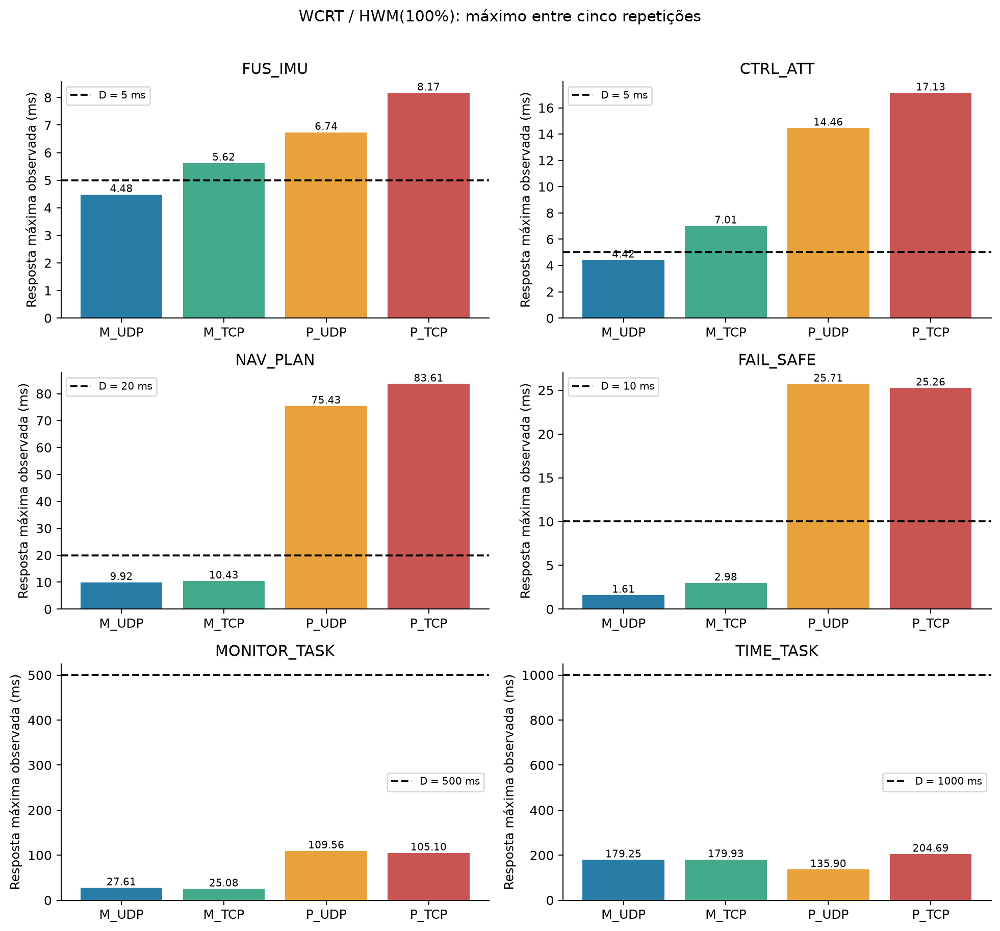
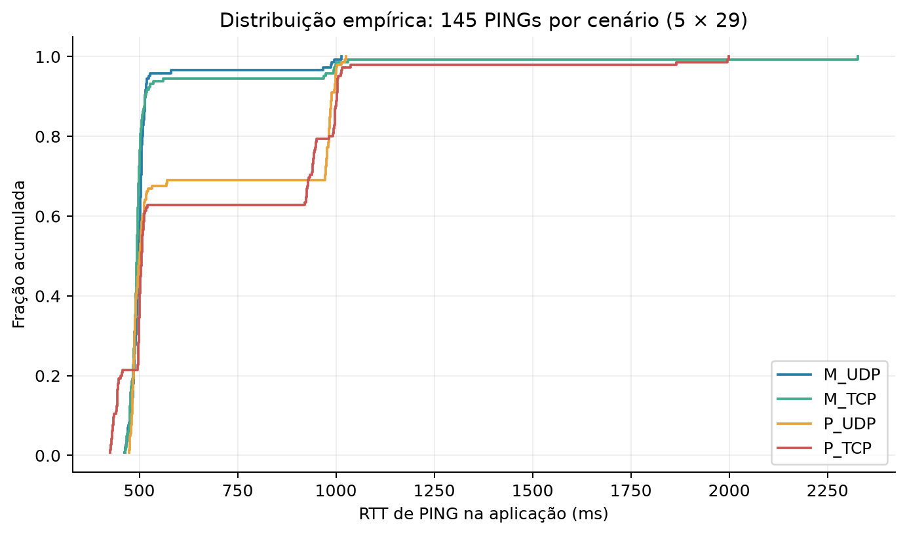
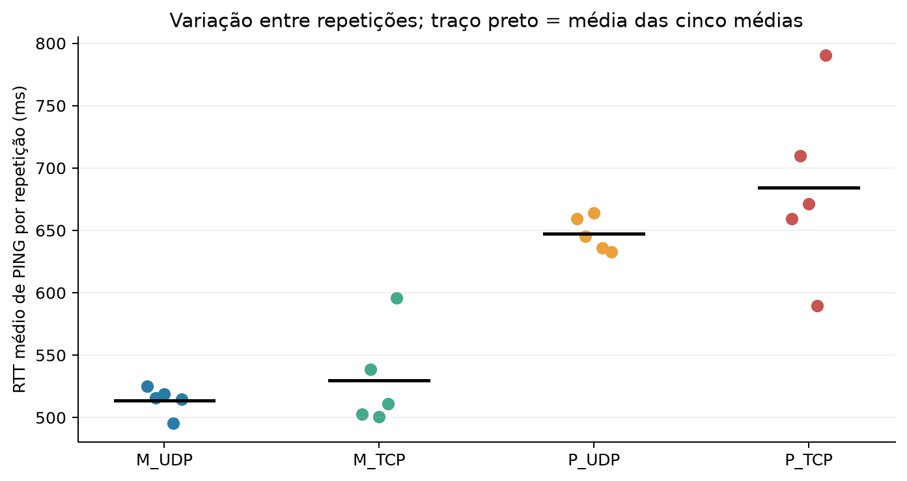
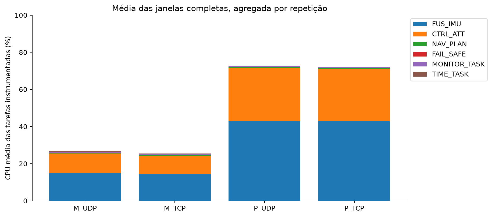
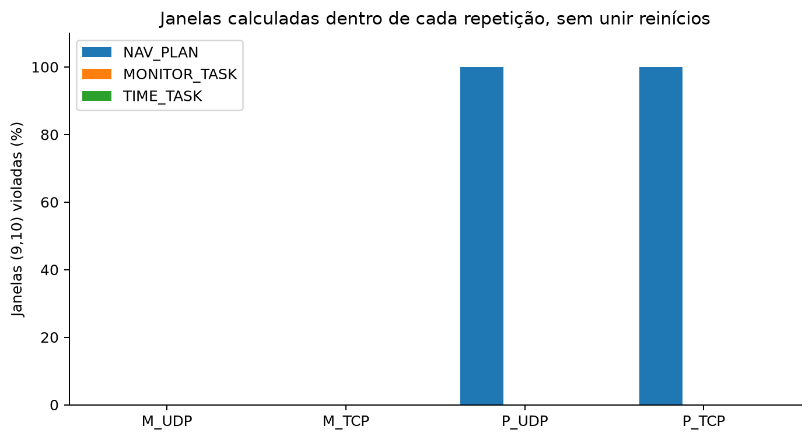
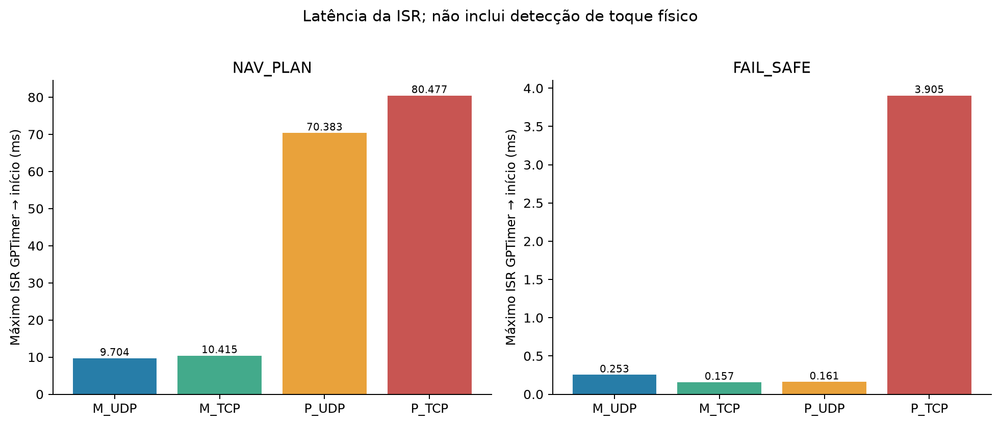
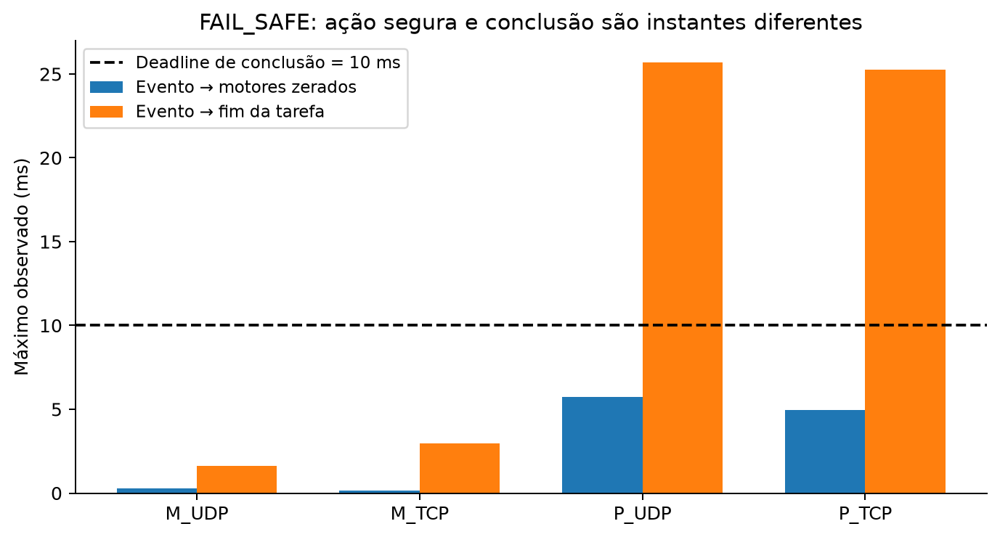
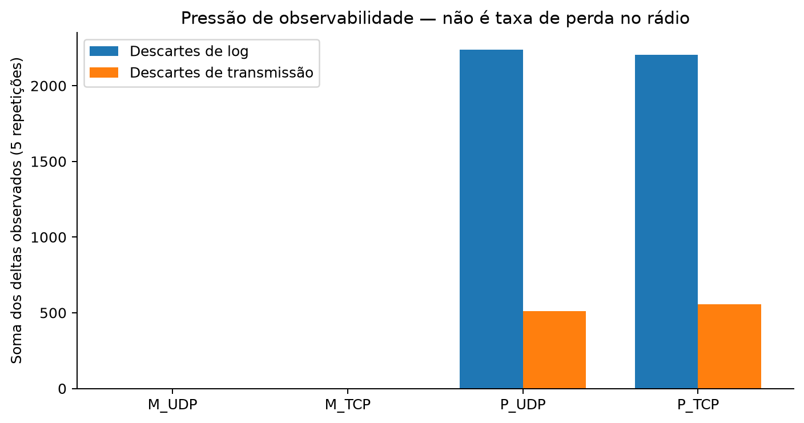

# Discussão dos resultados

## Atendimento temporal

A campanha permite comparar quatro configurações concretas, nas condições
medidas. M_UDP foi a única que cumpriu todos os prazos nas cinco janelas.
M_TCP apresentou 13 violações de prazo e sete ativações perdidas. Nos cenários
P, o número de falhas hard aumenta para 1911 em UDP e 3081 em TCP, incluindo
perdas. Esses resultados indicam menor previsibilidade temporal da configuração
DM/cooperativa/80 MHz sob a carga instrumentada, mas não isolam qual das três
mudanças de configuração explica cada diferença.

As falhas são evidências de descumprimento nas condições experimentais.
Não devem ser apagadas ou convertidas em sucesso por haver poucas ocorrências.
O máximo observado por tarefa e cenário está em [TABELAS.md](TABELAS.md).
A comparação com a linha de deadline mostra diretamente a margem ou a
ultrapassagem. O tempo C medido é decorrido, podendo incluir preempções e
esperas; seu aumento não deve ser interpretado exclusivamente como aumento
do número de instruções executadas pela tarefa.

## UDP e TCP

As médias de RTT dos PINGs foram 513,888 ms (M_UDP), 529,745 ms (M_TCP),
647,473 ms (P_UDP) e 684,204 ms (P_TCP). UDP teve menor média de RTT e menos
falhas hard em ambas as configurações comparadas. Assim, **UDP apresentou
o melhor resultado observado para esta aplicação e campanha**, enquanto
P_TCP teve o pior atendimento temporal entre os quatro cenários.

Essa conclusão é experimental e restrita: todas as 840 mensagens programadas
tiveram confirmação nas pastas selecionadas, portanto não há evidência de
vantagem TCP na taxa de confirmação desses comandos. Também não foi feito
um ensaio de perdas de rede controladas que permita comparar robustez dos
transportes. TCP tem mecanismos próprios de retransmissão e ordenação;
a instrumentação não separa seu custo do escalonamento, filas e condições de
rádio. Os blocos de execução e as faixas de RSSI diferentes impedem atribuir
toda a diferença ao protocolo isoladamente.

O período de 500 ms do MONITOR_TASK explica por que o RTT de aplicação não
é comparável a um ping ICMP típico. Uma mensagem pode esperar a próxima
ativação, processamento e disponibilidade de transmissão. A figura ECDF
apresenta a distribuição dos 145 PINGs por cenário; a figura de repetições
apresenta as cinco médias, que são as unidades de repetição experimental.
Não tratar os 145 PINGs como 145 ensaios independentes.

## Interferência, bloqueio e consumo de CPU

Em CUSTOM, as prioridades da aplicação são FAIL_SAFE=5, FUS=4, CTRL=3,
NAV=2 e MONITOR/TIME=1. Sob preempção, tarefas prontas de maior prioridade
podem interromper as de menor prioridade. NAV e as tarefas de comunicação
estão expostas à interferência do controle, além dos serviços do SDK.
Em DM, FUS/CTRL=5, FAIL_SAFE=4, NAV=3 e MONITOR/TIME=1; com preempção
desligada, uma tarefa pronta depende dos pontos de bloqueio ou yields
para obter CPU. A frequência de 80 MHz também aumenta o tempo decorrido
da carga de trabalho fixa em relação a 240 MHz.

As filas encadeiam produção e consumo. CTRL usa o estado mais recente;
quando há substituição de uma amostra pendente, a perda é contabilizada.
Espera por mensagem é suspensão à espera de um evento, não evidência automática
de inversão de prioridade. A aplicação utiliza seções críticas com portMUX,
que podem adiar interrupções e despacho. Não há mutex de aplicação com
herança ou teto de prioridade a comparar. Serviços Wi-Fi, lwIP e timers
também competem por recursos; os logs não fornecem rastreamento completo
para decompor causalmente cada miss em interferência e bloqueio.

O gráfico de CPU contém somente as seis tarefas instrumentadas, em janelas
completas de 5 s. A diferença até 100% não é medida de ociosidade: existem
outras tarefas do SDK e de instrumentação. A análise não usa tempo decorrido
do corpo da tarefa como substituto da ocupação exclusiva de CPU.

## (9,10)-firm e tarefas soft

NAV, MONITOR e TIME foram classificadas como soft pela possibilidade de
tolerar atraso ocasional nessas funções auxiliares, sob as hipóteses do
autopiloto didático. NAV teve zero violações nos cenários M. Nos cenários P,
houve 15 misses NAV por repetição e todas as 13 janelas de dez execuções
violaram (9,10). Logo, não basta descrever esse comportamento como
"soft aceitável": o critério adotado foi descumprido.

MONITOR e TIME atenderam (9,10) nas janelas analisadas. As janelas são
formadas separadamente em cada reinicialização; as tabelas somam contagens,
sem criar janelas artificiais na fronteira entre repetições.

## ISR e ação segura

A latência medida começa no callback da ISR GPTimer e termina no início
da tarefa. Não inclui aquisição do sensor touch nem o contato do dedo.
O modo físico disponibilizado para apresentação precisa de uma execução
específica antes de constituir evidência experimental.

FAIL_SAFE registra dois instantes: motores simulados zerados e conclusão
da carga da tarefa. Uma ação segura anterior ao deadline não permite
afirmar que a tarefa inteira terminou dentro dele. A figura distingue ambos.
Os comandos FS da agenda chegam depois da emergência automática aos 24 s;
portanto reafirmam o estado seguro. A campanha não demonstra três novas
transições remotas do estado normal para emergência.

## Observabilidade, SNTP e limites de inferência

Os registros NAV/FS e os acumuladores finais estão completos nas 20 pastas
selecionadas, mas os cenários P apresentam descartes de logs secundários e
de transmissão. M_TCP/R05 também registra dois descartes de transmissão.
Os acumuladores locais continuam contando os jobs; a falta de uma amostra
de log não elimina seu efeito nos contadores de deadline.
Os deltas observados incluem a recepção final e não constituem taxa de
perda de pacotes no rádio limitada à janela de 60 s.

Os timestamps UTC e as consultas SNTP constam das tabelas de comunicação.
A resolução de milissegundos não garante exatidão de um milissegundo.
O RTT monotônico evita subtrair dois relógios diferentes; uma latência
unidirecional calculada por UTC exigiria tratar offset, deriva e assimetria.
HWM99 das tarefas é intervalo de histograma, com overflow acima de 102,4 ms;
o relatório não apresenta a média dos percentis individuais como percentil global.

As primeiras R01 de P_UDP/P_TCP acompanham o conjunto como evidências
complementares. Usar a primeira R01 TCP altera o total hard de 3081 para
3087, sem mudar a ordenação observada. A primeira UDP tinha um registro
NAV ausente, que permanece documentado. Essa proveniência evita ocultar
resultados anteriores ou selecionar apenas as execuções com menos falhas.

## Conclusão experimental

A integração de rede e relógio foi exercitada nos quatro cenários. A
configuração CUSTOM/preemptiva/240 MHz com UDP foi a única que satisfez
todos os prazos nas cinco repetições. A configuração DM/cooperativa/80 MHz
não satisfez o critério hard nem o (9,10) de NAV. O resultado fundamenta
a escolha experimental de M_UDP para a demonstração automática, sem
transformá-la em garantia de comportamento para toda carga ou condição de rede.
