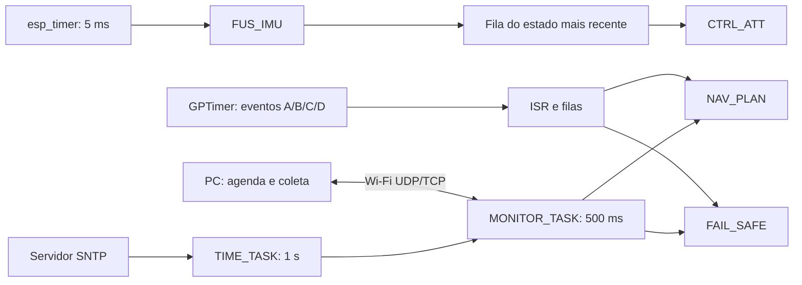

# Metodologia e definição das medidas

## Configuração experimental

O autopiloto didático utiliza FUS_IMU, CTRL_ATT, NAV_PLAN, FAIL_SAFE,
MONITOR_TASK e TIME_TASK na ESP32 com FreeRTOS. A execução é unicore, com tick
de 1 ms. O projeto deriva da M1 e acrescenta comunicação Wi-Fi e sincronização
SNTP para investigar o efeito dessas operações no atendimento temporal.

| Cenário | Referência M1 | Política | CPU | Preempção | Time slicing | Transporte |
|---|---|---|---:|---|---|---|
| M_UDP | 02 | CUSTOM | 240 MHz | Ligada | Ligado | UDP |
| M_TCP | 02 | CUSTOM | 240 MHz | Ligada | Ligado | TCP |
| P_UDP | 07 | DM | 80 MHz | Desligada | Configurado ligado | UDP |
| P_TCP | 07 | DM | 80 MHz | Desligada | Configurado ligado | TCP |

Os cenários 02 e 07 da M1 foram escolhidos pelo atendimento de prazos hard,
seguido do comportamento soft. CUSTOM/240 MHz foi a referência entre
configurações sem misses. A M1 possui uma execução por combinação; as referências
não constituem extremos garantidos para qualquer carga. No modo cooperativo,
time slicing configurado não significa alternância preemptiva pelo tick.

Cada cenário tem cinco repetições de 60 s, com reinicialização da ESP32 entre
elas. A quantidade e a duração são escolhas experimentais: o enunciado pede
vários testes, mas não prescreve esses números. A ordem efetiva foi principalmente
em blocos por cenário, após pilotos. As coletas não foram randomizadas nem
pareadas por condição instantânea de rádio. RSSI inicial/final e canal estão
em `tabelas/repeticoes.csv`; as datas e horários preservam a ordem real.

## Estímulos e comunicação

O coletor aguarda conexão e sincronização inicial antes do comando BEGIN.
O intervalo monotônico da ESP32 define os 60 s. A agenda do PC tem origem no
primeiro envio BEGIN, de modo que sua fase é conferida sem presumir que seja
idêntica à origem da ESP32. Há 42 comandos por repetição: 29 PING, 9 NAV
antes do fail-safe, uma NAV posterior (recusada como SAFE_ACTIVE) e 3 FS.
Cada comando programado tem um envio de aplicação e prazo comum de 5 s para
observar ACK. O envio não espera o ACK anterior. TCP ainda pode retransmitir
internamente; isso não corresponde a retry de aplicação.

O roteiro automático tem 14 eventos em 13 alarmes, até 26 s: A=1, B=5,
C=7 e D=1; B+C coincidem aos 22 s. A injeta estresse; D ocorre aos 24 s.
São esperados 13 jobs NAV pela instrumentação, incluindo A/STRESS, mais 9 NAV
remotas; FAIL_SAFE executa uma vez por D e três por comandos remotos.
O estado seguro fica travado até reinicialização. Os FS remotos posteriores
reafirmam esse estado, sem constituir novos pousos independentes.

## Tempos e classificações

| Tarefa | Classe adotada | Origem do evento | Prazo |
|---|---|---|---:|
| FUS_IMU | Hard | Liberação nominal periódica | 5 ms |
| CTRL_ATT | Hard | Timestamp da amostra no início da FUS | 5 ms |
| NAV_PLAN | Soft | ISR ou recepção/aceitação do comando | 20 ms |
| FAIL_SAFE | Hard | ISR ou recepção/aceitação do comando | 10 ms |
| MONITOR_TASK | Soft | Liberação nominal periódica | 500 ms |
| TIME_TASK | Soft | Liberação nominal periódica | 1000 ms |

FUS e CTRL são hard pela dependência do controle sobre amostras recentes;
uma amostra atrasada ou perdida pode comprometer a atualização de atitude.
FAIL_SAFE é hard pela necessidade de reduzir throttle em emergência.
NAV tolera atraso ocasional em rota/telemetria sem substituir o controle
rápido. MONITOR e TIME são tratadas como soft por exercerem comunicação e
referência temporal; essa classificação não transforma o caminho completo
PC → emergência em um mecanismo com garantia hard de 10 ms.

Definições usadas nos arquivos:

- Resposta: `fim - evento`; WCRT/HWM100 é o maior valor observado.
- C decorrido: `fim - início`; inclui preempções e esperas ocorridas dentro
  do trecho instrumentado. Não é tempo exclusivo de CPU nem WCET formal.
- Latência ISR: `início - evento` apenas nos jobs originados na ISR.
- FAIL_SAFE também registra o instante em que os motores simulados são zerados,
  anterior ao fim da carga de trabalho. São duas medidas distintas.
- Miss: resposta estritamente maior que o prazo. Perda: ativação descartada ou
  sobrescrita, que não produz execução concluída. Invalidade temporal é separada.
- Percentual de misses: `misses/jobs executados`. Percentual de falhas sobre
  ativações: `(misses + perdas + inválidas)/(jobs + perdas + inválidas)`.
- Para FUS/MONITOR/TIME, jitter é atraso de início em relação à liberação nominal;
  para as tarefas por evento, é a variação absoluta da latência entre jobs.
  Não comparar esses valores como se fossem a mesma definição de jitter de período.

## HWM, CPU e (m,k)-firm

Os acumuladores locais abrangem todos os jobs válidos cuja origem esteja na
janela de medição. A recepção final permite concluir jobs iniciados perto do
limite; esse período de coleta final não amplia os 60 s.
HWM99 é obtido por histograma de 100 us: o resultado é um intervalo, com
overflow acima de 102,4 ms. Não foram calculados percentis globais de tarefas
a partir dos cinco percentis individuais. O CSV por cenário fornece apenas
o envelope dos intervalos individuais, explicitamente identificado.

A ocupação de CPU vem das janelas completas de 5 s no serial. Primeiro
calcula-se a média de cada repetição; depois, a média das cinco repetições.
O gráfico soma somente as seis tarefas instrumentadas: não representa
utilização total do sistema nem permite atribuir o complemento a idle.
Tarefas de rede, temporizadores e instrumentação também consomem CPU.

O modelo adotado para tarefas soft é (9,10): pelo menos nove execuções
devem cumprir seus prazos em cada janela de dez. As janelas deslizam dentro
de cada repetição e não atravessam reinícios. São 13 janelas NAV, 111 MONITOR
e 51 TIME por repetição. Perdas ou invalidade tornam a conclusão sobre todas
as ativações inconclusiva; não são omitidas para melhorar o resultado.

## RTT, SNTP e tamanhos

O RTT usa o relógio monotônico do PC: `recepção ACK - envio do comando`.
Somente os 29 PINGs da agenda entram na comparação de PING; HELLO, BEGIN e
REPORT são excluídos. As 145 amostras de cada cenário formam uma distribuição
empírica, enquanto a variação experimental é apresentada pelas cinco médias
por repetição. Percentis de RTT usam o método nearest-rank.

SNTP fornece timestamps UTC na ESP32 e estimativas de offset no PC. As
consultas iniciais/finais do PC estão em `sntp_por_repeticao.csv`; os ACKs
correlacionados e seus timestamps/bytes estão em `timestamps_comunicacao.csv`.
Não se presume precisão de 1 ms por haver campos em milissegundos. Offset,
deriva e assimetria não são limitados por essa instrumentação. Por isso a
comparação quantitativa principal usa RTT monotônico, sem apresentar a
subtração entre relógios como latência unidirecional exata do rádio.
Os tamanhos são bytes de aplicação, excluindo cabeçalhos e retransmissões do enlace.

## Seleção e rastreabilidade

As tabelas principais usam R01 a R05 das quatro pastas ativas. P_UDP/R01 foi
repetida após uma execução com 21/22 registros NAV, hard=423 e soft=15.
A repetição incluída tem todos os registros, hard=403 e soft=15. Sua substituição
não apaga o fato de que ocorreu perda de observabilidade.

P_TCP/R01 também foi repetida, embora a primeira já estivesse conferida.
A tabela principal usa a pasta ativa com hard=628 e soft=15. A primeira
execução tinha hard=634 e soft=15. Usando a primeira R01, o total P_TCP seria
3087 em vez de 3081; a conclusão comparativa frente a P_UDP não muda.
O resultado válido anterior deve acompanhar a proveniência da amostra,
sem ser classificado como erro nem selecionado pelo menor número de falhas.

O inventário de integridade identifica os arquivos usados em cada geração.
A análise não altera firmware, logs, contadores ou a classificação das coletas.
