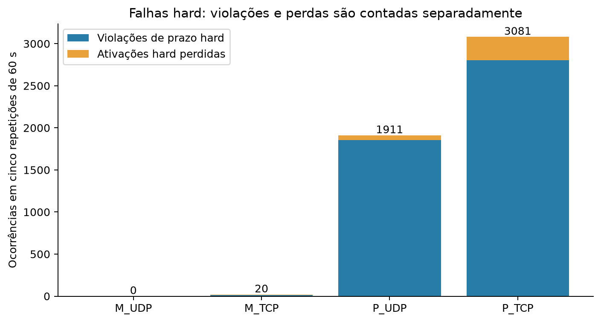

# Análise experimental — Drone ESP32 / M2

Este material reúne a base quantitativa e as discussões para o relatório da M2.
A campanha AGENDA_60S_R2 contém quatro cenários e cinco repetições de 60 s em
cada cenário, com firmware `M2-METRICS-4`. As 20 coletas foram concluídas e
conferidas; o atendimento de prazos depende do cenário.

## Organização

- [Metodologia e definições](METODOLOGIA.md): configuração, carga, origem de cada medida e agregações.
- [Tabelas consolidadas](TABELAS.md): resultados por cenário e pelas seis tarefas.
- [Discussão dos resultados](DISCUSSAO.md): interpretação, interferência, bloqueio e comparação UDP/TCP.
- [Atendimento ao enunciado](REQUISITOS.md): correspondência entre itens do PDF e evidências.
- [Tabelas CSV](tabelas/): dados por repetição, por tarefa, amostras PING, SNTP e timestamps.
- [Figuras PNG/PDF](figuras/): versões prontas para inclusão no relatório.
- [Resultados estruturados](resultados.json): agregados e resultados por repetição.

## Resultado principal

| Cenário | Configuração | Hard: violações + perdas | Soft: violações | PING médio |
|---|---|---:|---:|---:|
| M_UDP | CUSTOM, preemptivo, 240 MHz, UDP | 0 | 0 | 513,888 ms |
| M_TCP | CUSTOM, preemptivo, 240 MHz, TCP | 20 | 0 | 529,745 ms |
| P_UDP | DM, cooperativo, 80 MHz, UDP | 1911 | 75 | 647,473 ms |
| P_TCP | DM, cooperativo, 80 MHz, TCP | 3081 | 75 | 684,204 ms |

M_UDP foi a configuração com melhor atendimento de prazos neste conjunto de
experimentos. P_TCP apresentou o maior total de falhas hard. Os cenários M/P
alteram simultaneamente política, frequência e preempção; portanto a comparação
não isola o efeito de cada parâmetro. A diferença UDP/TCP também está sujeita
às condições de rede e à ordem das execuções.




## Reprodução da análise

Na raiz do repositório, com Python:

```powershell
python -m pip install -r analise_final/requirements.txt
python tools/gerar_analise_final.py
```

Para gerar somente tabelas, sem dependência gráfica:

```powershell
python tools/gerar_analise_final.py --sem-graficos
```

Os parâmetros `--dados CAMINHO` e `--saida CAMINHO` permitem usar outro diretório.
O diretório de entrada deve conter `M_UDP`, `M_TCP`, `P_UDP` e `P_TCP`, cada um
com `R01` a `R05`. O gerador não modifica os dados de entrada. CSVs usam
separador `;`, codificação UTF-8 com BOM e ponto decimal; no Excel, importar
explicitamente essas convenções se a configuração regional usar vírgula decimal.

## Delimitação da evidência

Os eventos da campanha são gerados pela ISR do GPTimer. A latência apresentada
não é latência do toque capacitivo. A disponibilidade de um modo físico para
demonstração não transforma as coletas automáticas em evidência de touch físico.
Os prazos foram cumpridos em todas as cinco janelas M_UDP, sem garantia formal
para condições não medidas. As coletas dos demais cenários são válidas como
observação de descumprimento de prazos.

Os acumuladores das seis tarefas e os registros NAV/FS estão completos nas
20 pastas selecionadas; logs periódicos secundários são amostrados e sofrem
descartes nos cenários P. Esse limite está documentado na discussão.

As primeiras execuções R01 de P_UDP e P_TCP foram repetidas. A primeira UDP
tinha um registro NAV ausente; a primeira TCP era válida. A seleção e a
sensibilidade dos resultados estão descritas na metodologia. Isso é parte da
proveniência da amostra, não uma exclusão de resultados por desempenho.
