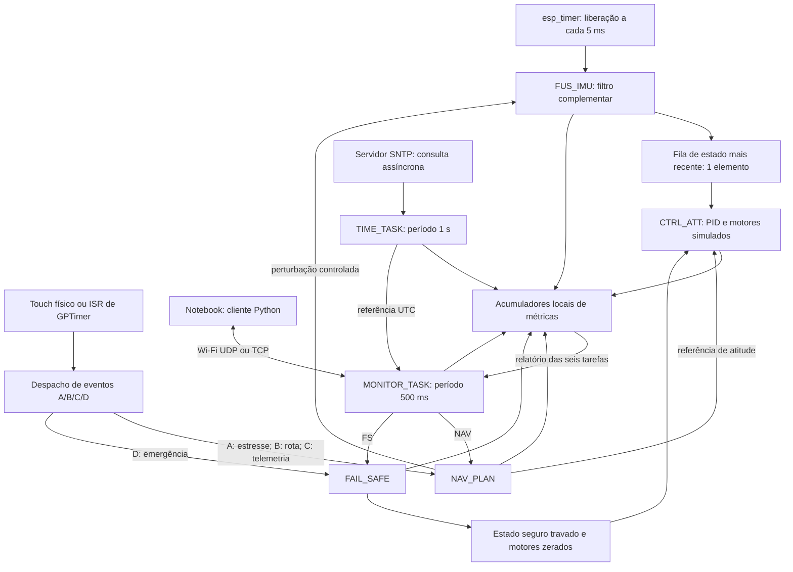

# Arquitetura do autopiloto didático

O sistema foi desenvolvido em C sobre FreeRTOS/ESP-IDF 6.1 para uma ESP32
clássica. A aplicação representa um autopiloto didático: os sinais inerciais,
o controle dos motores e os comandos de rota são simulados. Não há um drone
físico em voo nem acionamento PWM de motores nesta implementação.

A execução experimental utiliza um único núcleo, tick de 1 ms e seis tarefas
funcionais. Duas tarefas auxiliares, `METRICS` e `EXP_GUIDE`, produzem saídas
de acompanhamento e consomem recursos, embora não sejam funções do autopiloto.

## Fluxo de dados

## Tarefas, prazos e classificação

| Tarefa | Ativação | Prazo relativo | Função | Classificação adotada |
|---|---|---:|---|---|
| FUS_IMU | Periódica, 5 ms | 5 ms | Filtro complementar de sinais inerciais simulados | Hard |
| CTRL_ATT | Estado publicado pela FUS | 5 ms após o timestamp da amostra | PID e atualização dos quatro motores lógicos | Hard |
| NAV_PLAN | Eventos A/B/C ou comando NAV do PC | 20 ms | Estresse, waypoint e telemetria | Soft |
| FAIL_SAFE | Evento D ou comando FS do PC | 10 ms | Trava de segurança e redução imediata dos motores a zero | Hard |
| MONITOR_TASK | Periódica, 500 ms | 500 ms | Recepção de comandos, ACKs e envio de logs | Soft |
| TIME_TASK | Periódica, 1 s | 1 s | Referência SNTP e acompanhamento dos ciclos desde a sincronização | Soft |

A classificação hard de FUS e CTRL decorre da função de manter estado e
controle atualizados em um sistema de voo. Amostras antigas ou descartadas
podem comprometer a estabilidade. FAIL_SAFE é hard pela necessidade de
resposta de emergência. Essa justificativa se refere à função representada;
o protótipo não demonstra estabilidade de uma aeronave real.

NAV e telemetria toleram degradação pontual com perda de qualidade de serviço.
MONITOR e TIME foram tratados como soft para avaliar comunicação e manutenção
da referência temporal sem equiparar cada atraso a uma falha imediata de voo.
Isso não torna aceitável uma latência arbitrária de um comando remoto de
emergência: o prazo local de FAIL_SAFE começa na recepção registrada na ESP32,
enquanto o atraso completo desde o notebook precisa ser analisado à parte.

## Políticas de prioridade

Valores maiores indicam maior prioridade no FreeRTOS.

| Tarefa | CUSTOM | DM | RM disponível para demonstração |
|---|---:|---:|---:|
| FAIL_SAFE | 5 | 4 | 4 |
| FUS_IMU | 4 | 5 | 5 |
| CTRL_ATT | 3 | 5 | 5 |
| NAV_PLAN | 2 | 3 | 3 |
| MONITOR_TASK | 1 | 1 | 1 |
| TIME_TASK | 1 | 1 | 1 |

CUSTOM favorece a emergência, seguida da cadeia de controle. DM atribui a
maior prioridade aos prazos de 5 ms, seguida dos prazos de 10 e 20 ms.
MONITOR e TIME compartilham a prioridade 1, apesar de seus deadlines distintos;
portanto a implementação denominada DM não constitui uma ordenação estrita
dos seis deadlines em seis prioridades diferentes.

A opção RM usa, nesta implementação, a mesma atribuição numérica de DM.
O código considera o período de 5 ms da cadeia FUS/CTRL e o intervalo mínimo
associado ao debounce dos eventos; eventos assíncronos não se tornam tarefas
periódicas por essa escolha. RM não integrou a matriz final de quatro cenários.

Nos cenários preemptivos, uma tarefa pronta de maior prioridade pode tomar a
CPU da tarefa em execução. No modo cooperativo, a mudança de tarefa depende
de bloqueios e pontos de yield; manter a configuração de time slicing ligada
não cria a alternância preemptiva por tick quando a preempção está desligada.

## Comunicação entre tarefas e proteção do estado

FUS publica o estado em uma fila de capacidade um. A escolha preserva a
amostra mais recente: se a anterior ainda estiver pendente, sua substituição
é contabilizada como ativação perdida de CTRL. Assim, menos execuções de CTRL
não são interpretadas como sucesso por ausência de jobs concluídos atrasados.

NAV utiliza uma fila de oito eventos. FAIL_SAFE possui fila exclusiva de um
elemento. A recepção de eventos pela ISR usa as variantes `FromISR`; os
comandos do PC são despachados no contexto da MONITOR_TASK. As origens são
registradas separadamente para não misturar latência de ISR e recepção de rede.

O estado compartilhado de atitude, motores e segurança é protegido por
seções críticas. Acumuladores e referência de tempo também possuem proteção
local. A aplicação não implementa mutex com herança de prioridade (PIP) nem
protocolo de teto (PCP). As seções críticas introduzem trechos não preemptíveis
e custo de sincronização; isso é diferente de demonstrar uma inversão de
prioridade clássica com mutex e tarefa intermediária.

Esperar em `xQueueReceive` por uma nova amostra é uma dependência funcional e
retira a tarefa da disputa pela CPU. Essa espera não prova inversão de
prioridade. Já uma tarefa pronta pode sofrer interferência de tarefas mais
prioritárias, de atividades do SDK e de interrupções. No modo cooperativo,
também há postergação enquanto outra tarefa não alcança um ponto de cessão.

## Interferência temporal esperada

Em CUSTOM preemptivo, FS pode interferir nas demais tarefas da aplicação;
FUS interfere em CTRL, NAV, MONITOR e TIME; CTRL interfere nas três últimas.
As tarefas de prioridade 1 também compartilham CPU com METRICS e EXP_GUIDE.
Essa descrição não inclui toda a plataforma: Wi-Fi, lwIP, esp_timer, idle e
rotinas do kernel fazem parte do ambiente de execução.

Em DM, FUS e CTRL possuem a mesma prioridade. A emergência tem prioridade
inferior à cadeia de controle, e NAV é inferior a ambas. No cenário P,
reduzir a frequência para 80 MHz alonga a carga computacional fixa, enquanto
o escalonamento cooperativo modifica as oportunidades de execução. Como
prioridade, frequência e preempção mudam juntas entre M e P, seus efeitos
individuais não podem ser isolados pela matriz final.

O monitor executa a cada 500 ms e tem prioridade 1. Um comando pode aguardar
o próximo ciclo e ainda sofrer atraso por escalonamento e filas. A prioridade
de FAIL_SAFE não elimina essa espera anterior à sua ativação. O RTT medido
no PC inclui esses componentes e não representa somente a transmissão de rádio.

## MONITOR_TASK e transporte

A aplicação usa mensagens JSON, identificadores de sessão e sequência e
porta 5000. UDP preserva mensagens em datagramas; TCP utiliza delimitação por
linha e tratamento de fragmentação/agrupamento. O cliente correlaciona ACKs
por sessão/sequência e registra o instante de envio e recepção.

ACKs e relatórios de controle têm preferência sobre logs de fundo. Registros
de NAV/FS possuem fila própria, separada dos logs periódicos. Essa organização
favorece a observabilidade dos eventos sem transformar a rede em armazenamento
ilimitado: filas finitas e falhas de envio podem produzir descartes, contabilizados
separadamente dos misses e perdas de ativação das tarefas.

## TIME_TASK e SNTP

TIME_TASK executa a cada segundo. O cliente SNTP do ESP-IDF opera de forma
assíncrona, com intervalo configurado de 20 s na campanha. O callback de
sincronização registra a referência UTC e o instante monotônico correspondente.
A tarefa informa a hora, o número de sincronizações, a idade da referência
e quantos ciclos executou desde a última atualização.

O ciclo de 1 s não implica uma consulta de rede a cada segundo. A contagem
de ciclos refere-se a execuções de TIME_TASK, não a ciclos do processador.
O notebook consulta SNTP e registra sua estimativa de offset; o RTT usa um
relógio monotônico local e não depende da igualdade entre relógios dos dois
dispositivos. Diferenças UTC entre dispositivos exigem considerar incerteza,
assimetria e deriva, mesmo quando os timestamps incluem milissegundos.

## Instrumentação e limites das medidas

Para um job, registram-se evento `e`, início `s` e fim `f`:

- Resposta: `R = f − e`; miss quando `R > D`.
- Latência de ativação: `L = s − e`.
- Tempo decorrido do corpo da tarefa: `C_observado = f − s`.
- WCRT observado/HWM100: maior resposta entre os jobs válidos da janela.

O tempo decorrido pode incluir preempções, esperas internas e saída serial;
não é CPU exclusiva nem uma prova formal de WCET. Os acumuladores ficam na
ESP32 e incluem todos os jobs válidos. O custo da instrumentação existe, mas
o registro das métricas ocorre após o timestamp final de cada corpo medido.

O evento de FUS é sua liberação nominal pelo temporizador. CTRL usa o instante
de aquisição da amostra no início da FUS, incluindo fusão e fila em sua resposta.
NAV/FS usam a origem ISR ou recepção do comando. FS também registra o instante
em que os motores foram zerados, separado do fim de sua carga computacional.

HWM99 é reportado por intervalo de um histograma de 100 µs. Respostas acima
de 102,4 ms entram em overflow e exigem um limite superior mais amplo.
Não se deve calcular um percentil global tomando a média dos percentis das
repetições. CPU é obtida de contadores de execução em janelas completas de
5 s contidas na medição; a soma das seis tarefas não equivale à ocupação
total da plataforma.

## Entradas físicas e automáticas

| Entrada | Touch | GPIO | Ação |
|---|---:|---:|---|
| A | T0 | 4 | Solicita estresse de carga |
| B | T7 | 27 | Atualiza navegação |
| C | T4 | 13 | Telemetria |
| D | T9 | 32 | Emergência |

O firmware oferece modos físico e automático, selecionados na configuração
de compilação. A campanha publicada utilizou exclusivamente GPTimer. Ambas
as fontes chegam à rotina de despacho de eventos, mas a automação não
reproduz o tempo de detecção capacitiva nem demonstra contato físico.
Consequentemente, as figuras dessa campanha usam o termo **latência ISR
GPTimer → tarefa**, e não latência de toque.

O estado seguro permanece ativo até reinicialização. A execução automática
de D aos 24 s precede os FS remotos da agenda: estes confirmam a execução
em estado já seguro. O acionamento do LED da placa pelo comando remoto,
previsto como ponto extra no enunciado, não faz parte desta implementação.

## Organização do código

| Arquivo | Responsabilidade |
|---|---|
| `main/main.c` | Modelo do drone, tarefas FUS/CTRL/NAV/FS, filas, estado e instrumentação |
| `main/event_script.c` | Roteiro temporal A/B/C/D |
| `main/event_auto.c` | Alarmes GPTimer e despacho pela ISR |
| `main/monitor.c` e `monitor_protocol.c` | Wi-Fi, transporte, comandos e envio de métricas |
| `main/time_task.c` | SNTP, referência UTC e ciclos de TIME_TASK |
| `main/experiment.c` | Acumuladores de janela, histogramas e (m,k) |
| `pc/agenda.py` | Agenda absoluta de comandos do PC |
| `pc/executar_ensaio.py` | Coordenação, persistência e validação da coleta |
| `tools/analisar_ensaio.py` | Interpretação das estatísticas e conferência dos registros |

Referência dos requisitos: [enunciado M2](../Trabalho%20M2%20-%20STR%20.pdf).
