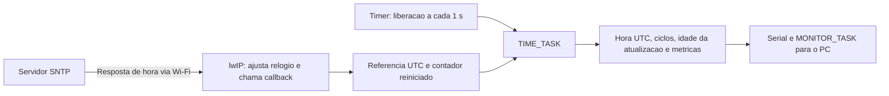

# TIME_TASK: sincronizacao e impacto

Implementacao desta etapa: tarefa periodica com **T = D = 1 s**, prioridade 1,
core 0 e stack de 4096 bytes. O enunciado fornece D e periodicidade; T=1s e uma
escolha de modelagem. A prioridade e igual a MONITOR_TASK, inferior as quatro
tarefas funcionais. Com slicing desligado, elas cedem CPU ao bloquear; essa
igualdade de prioridades deve constar da descricao dos experimentos.



## O que muda

- O tempo desde o boot continua em microssegundos monotônicos. Duracoes, RTT
  do PC e deadlines nao dependem de ajustes SNTP.
- Apos resposta SNTP, tambem existe uma referencia de calendario UTC. Os
  snapshots extrapolam a ultima amostra recebida usando tempo monotono.
  `Z` ou `+00:00` significa UTC, nao horario local de Brasilia.
- A cada job, a TIME_TASK verifica a rede, inicia/retoma SNTP quando necessario,
  contabiliza um ciclo, consulta a referencia, formata e imprime o estado.
- O SNTP consulta `pool.ntp.org` a cada **60 s** por padrao. O periodo da tarefa
  nao e o intervalo da consulta. A resposta chega em segundo plano pelo lwIP;
  nao se espera a resposta do servidor dentro de cada job.
- A callback so atualiza uma estrutura protegida por secao critica curta.
  Nao imprime, nao envia sockets e nao espera espaco em fila.
- Sem Wi-Fi/internet/servidor acessivel, os jobs continuam. Antes da primeira
  resposta nao se inventa uma data. Depois, a hora local continua avancando e
  a idade da ultima atualizacao revela que ela esta ficando antiga.

O intervalo SNTP e configuravel (15 a 86400 s). O SDK impoe minimo de 15 s;
DNS, tentativas e disponibilidade do servidor afetam o intervalo real.
[API oficial Espressif](https://docs.espressif.com/projects/esp-idf/en/v5.2/esp32/api-reference/system/system_time.html).
A implementacao usa a API `esp_netif_sntp` conferida no SDK local 6.1,
compartilhando a conexao Wi-Fi existente. Nao cria uma segunda interface.

## Primeiro teste na placa

1. No terminal ESP-IDF, execute `idf.py menuconfig`.
2. Em **M2 - Drone e experimentos**, mantenha o Wi-Fi, UDP e a origem PC que
   ja funcionaram. Marque **Habilitar TIME_TASK e sincronizacao SNTP**.
   Mantenha servidor `pool.ntp.org` e intervalo `60` segundos.
3. Salve, saia e rode `idf.py -p COM7 flash monitor` (ajuste a porta se mudou).
4. Observe `TIME_CONFIG`, `TIME` e depois `TIME_SYNC`. A sincronizacao pode
   demorar; a rede precisa permitir DNS e SNTP/UDP porta 123. A comunicacao local
   PC-ESP pode funcionar mesmo sem acesso a esse servidor externo.
5. Espere pelo menos duas atualizacoes recebidas para observar o contador
   reiniciar. Normalmente isso exige mais de um minuto, dependendo da rede.
6. Em outro terminal ESP-IDF, usando o IP efetivamente mostrado pela placa:

```powershell
python pc/monitor_pc.py --host 192.168.15.23 --protocol udp --output monitor_udp_time.jsonl --show-time
```

O IP acima foi o observado no teste anterior; confira se permanece igual.
`--show-time` e opcional: os dados sao salvos no JSONL mesmo sem essa opcao.
Enquanto chegam linhas TIME/JOB, o prompt continua aceitando PING/NAV/FS/SAIR.

Exemplos ilustrativos, nao resultados medidos:

```text
TIME | ciclo=1 | hora=AGUARDANDO_SNTP | wifi=ON | sync=0 | ciclos_desde_sync=-1 | idade_sync_ms=-1 | release_dropped=0
TIME_SYNC | atualizacoes=1 | mono_us=...
TIME | ciclo=4 | hora=2026-10-26T15:00:00.123Z | wifi=ON | sync=1 | ciclos_desde_sync=1 | idade_sync_ms=800 | release_dropped=0
```

`sync` conta respostas de sincronizacao recebidas. `ciclos_desde_sync` conta
jobs da TIME_TASK que chegaram ao ponto de contabilizacao desde a callback;
nao sao ciclos de CPU, pacotes nem segundos exatos. A callback zera essa
contagem; a proxima linha periodica normalmente mostra 1. Se a callback ocorrer
durante o job, pode mostrar 0. Antes da primeira atualizacao, -1 = indefinido.
`idade_sync_ms` mede o tempo monotono real desde a callback. Em sobrecarga,
ciclos e segundos podem divergir. `release_dropped` conta liberacoes que nao
couberam na fila de quatro posicoes; nao entram silenciosamente como jobs feitos.

## Como medir o impacto

As linhas `METRIC;...;TIME_TASK;...` passam a apresentar jobs, misses,
execucao minima/media/maxima, resposta, jitter e CPU. A TIME_TASK e inicialmente
classificada soft: atraso prejudica atualidade do relogio e observabilidade.
As linhas das demais tarefas continuam disponiveis para comparar interferencia.

- `exec_*`: tempo decorrido do inicio ao fim do corpo da tarefa, incluindo
  inicializacao/reinicio SNTP quando necessario, formatacao e printf. Exclui
  apenas o registro final das metricas e publicacao do job. Pode incluir
  preempcoes/esperas; nao e C puro de CPU nem WCET provado.
- `resp_*`: fim menos liberacao nominal; inclui espera para executar.
- `jitter_*` de TIME: desvio do inicio em relacao a liberacao nominal.
- `cpu_pct`: tempo de CPU da tarefa na ultima janela de 5 s. Trabalho SNTP/DNS
  executado pelo lwIP e trabalho do driver Wi-Fi pertencem a outras tarefas.
- O deadline de 1 s se aplica ao job periodico local, nao a garantia de que um
  servidor remoto respondera em 1 s. Inicializacao do timer fica antes dos jobs.
- A linha TIME de cada segundo e parte da carga medida. O envio de mais um job
  e um snapshot de hora por segundo tambem acrescenta trabalho ao monitor.

Como diagnóstico opcional, fora da matriz principal, compare TIME desabilitada/habilitada,
mantendo politica, preempcao/slicing, CPU, protocolo, entrada, comandos, duracao e
momento de conexao do cliente iguais. Registre a inicializacao separadamente da
fase estavel; inclua varias atualizacoes SNTP na coleta. Nao atribua todo miss a
TIME: ja existiam misses em FUS/CTRL nos testes anteriores sem ela.

Na revisão M2-METRICS-2, a FUS usa liberações nominais; perdas de amostras são
contabilizadas e HWM/(m,k)-firm são calculados localmente. A amostragem dos logs
individuais permanece, sem reduzir os acumuladores. A comparação entre cenários
ainda depende da revisão da agenda do PC e das coletas restantes.

## Dados enviados ao notebook

- `type=time`: ciclo, `unix_ms` UTC ou null, `time_synced`, `sync_count`,
  `cycles_since_sync`, `sync_age_ms`, `release_dropped` e `mono_us`.
- `ack`: acrescenta `queued_unix_ms` e `time_sync_count`. Marca a montagem do ACK,
  nao a transmissao no radio nem o instante de recepcao inicial do pacote.
- `job`: acrescenta `end_unix_ms` e `time_sync_count`, capturados na publicacao.
  Se o fim do job antecede a referencia SNTP atual, a data fica null. Logs antigos
  enfileirados antes de sincronizar nao recebem uma data retroativa.
- `status.time_synced`: true depois da primeira sincronizacao, inclusive se a
  rede cair posteriormente. Consulte a idade em `time` para avaliar frescor.

Os timestamps UTC tem resolucao de milissegundos, nao garantia de exatidao de
1 ms. Ajustes SNTP podem causar saltos de calendario. RTT continua calculado
inteiramente com o relogio monotono do PC; nao subtraia diretamente relogios
de dispositivos diferentes sem avaliar o erro de sincronizacao.

## Validacao

Compilacao e testes de software registrados em [VALIDACAO_TIME](VALIDACAO_TIME.md).
Primeira sincronização e ressincronização foram observadas na ESP32, incluindo
três novas atualizações durante M_UDP/R01_T02. Reconexão sob falha e comparação
de impacto entre cenários ainda dependem de validação específica.
